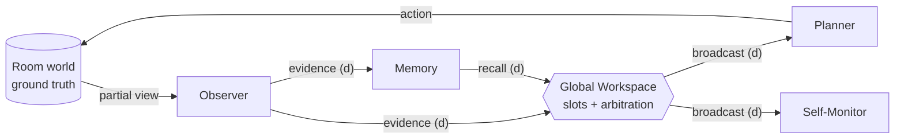

# SplitMind: Cognitive Coherence in Asynchronous Global-Workspace AI Systems

A small, fully deterministic simulation for studying what happens when a
modular, Global-Workspace-inspired (GWT-inspired) agent is split across
components that receive information at different times. Global Workspace
Theory is used here only as an architectural inspiration: a shared,
limited-capacity "workspace" to which specialised modules compete to
contribute. Nothing in this project makes or tests claims about
consciousness.

This repository contains the code, configurations, raw results and analysis
scripts for the paper *SplitMind: When Should a Distributed AI Trust Fresh
Information?* All results can be regenerated from this repository and are
deterministic given the seed.

## Key findings

* **Delay breaks agreement before it breaks behaviour.** Coherence between modules falls as soon as messages are delayed. Task success holds until delays are large, and loss of agreement typically came about one message delay before belief-driven mistakes. This is an ordering, not a predictor beyond delay.
* **With one information source, "newest wins" is hard to beat.** No rule was reliably better in task success in any of 72 single-source settings. The proposed staleness/conflict-aware rule did not beat it (negative result).
* **With several sources, "newest wins" becomes one of the worst rules.** On six held-out multi-source set-ups, rules that also weigh confidence, age and agreement improved workspace accuracy by 6 to 9 percentage points. The exception is when the fastest source is also the most reliable.
* **Self-monitoring.** The monitor avoided claiming certainty during internal conflict, but how often it said "I know" depended mainly on its assumed rate of world change.

## Where the paper's results live

| Paper | Results folder | Summary |
|---|---|---|
| Delay sweep | `results/latency/` | `results/summary.md` |
| Early-warning study | `results/phase2/coherence_failure/` | `NOTE.md` in the folder |
| Single-source grid (+ accumulating memory) | `results/phase2/volatility_noise*/` | `NOTE.md` in the folder |
| Three-fact world | `results/phase2/complex_environment/` | `NOTE.md` in the folder |
| Multiple scouts | `results/phase2/multi_source/` | `NOTE.md` in the folder |
| Self-monitor and its assumptions | `results/metacognition/`, `results/phase2/monitor_prior/` | `results/summary.md`, `NOTE.md` |
| Paper figures | `results/paper_figures/` | regenerate with `python analysis/paper_figures.py` |

Overall summaries: [`results/summary.md`](results/summary.md) (Phase 1) and
[`results/phase2/summary.md`](results/phase2/summary.md) (Phase 2). Every number
there is traceable to the generated `tables.md` files and the raw CSVs.

## 1. Research questions

1. How do communication latency and message staleness affect task performance?
2. How does latency affect **cognitive coherence**, i.e. agreement between the beliefs held by different modules?
3. Can workspace message-selection strategies reduce the damage done by stale or conflicting information?
4. Can a self-monitor detect when the system's knowledge is stale, incomplete or internally inconsistent?

## 2. Architecture



Every arrow labelled `(d)` is a network link with a logical delay. One step
runs a fixed pipeline: Observer → Memory → Workspace → Planner →
Self-Monitor → metrics → world update (`splitmind/simulation.py`).

| Module | File | Behaviour |
|---|---|---|
| Observer | `modules/observer.py` | Reports the key's room when it is seen directly (confidence 0.99) or when the remote beacon fires (confidence 0.8). Remembers its latest report. |
| Memory | `modules/memory.py` | Keeps the newest evidence it has *received*. Ignores older out-of-order evidence. Repeated agreeing evidence raises confidence (noisy-OR, capped at 0.99). Re-publishes its record every step, keeping the original evidence time. |
| Global Workspace | `workspace/base.py` | Keeps one slot per source holding that source's newest evidence. An arbitration strategy picks the content that is broadcast, along with every slot's value, confidence and evidence time. |
| Planner | `modules/planner.py` | Rule-based and deterministic. Acts only on the latest broadcast it has received: sweep if no belief, move toward the believed room, collect, then go to the exit. |
| Self-Monitor | `modules/self_monitor.py` | Reads the delayed broadcast and outputs `KNOWS`, `DOES_NOT_KNOW`, `HAS_CONFLICT` or `MAY_BE_STALE` with a confidence. A naive baseline monitor runs alongside it. |

### Message schema (`splitmind/messages.py`)

```python
@dataclass(frozen=True)
class Message:
    source: str; content: dict
    created_at: int      # time the underlying evidence was generated
    sent_at: int; delivered_at: int | None
    confidence: float
    world_version: int   # instrumentation only (see below)
    message_id: str; topic: str = "key_location"; relevance: float = 1.0
```

`age(now) = now - created_at`: the age of the evidence, not of the message.
`world_version` is the environment's change counter at evidence time. **Only
the metrics read it.** No module and no strategy may use it, so it cannot leak
ground truth into the system under test.

## 3. Environment (`splitmind/environment/`)

* Six rooms in a corridor (`room_a … room_f`). The agent moves one room per step.
* A key starts in a random room. With probability `p_move = 0.1` per step it jumps to a random other room. Each jump increments `world_version`. A held key never moves.
* The exit is in a fixed room that is known in advance. Task: collect the key, then exit within 50 steps.
* Partial observability: the key is seen only when it is in the agent's room. Otherwise, a beacon reports its room every 3 steps, and 10% of those readings name a wrong room.
* The key's trajectory and the beacon errors are pre-sampled from the seed. Every strategy therefore faces the same world events under the same seed (paired comparisons).
* `RoomWorld.ground_truth()` exposes the full state at every step.

## 4. Workspace strategies (`splitmind/workspace/`)

| Strategy | Rule |
|---|---|
| FIFO | Messages are processed in arrival order and each overwrites the content, so the last message delivered in a tick wins. Within a tick, messages are processed in send order. |
| Confidence-only | The slot with the highest confidence wins. |
| Freshness-only | The slot with the newest evidence wins (`score = -age`). |
| Staleness/conflict-aware | `score = relevance · confidence · exp(-λ·age) · (1 − δ·conflict)`. `conflict = 1` if a different value with newer evidence and confidence ≥ τ is present. An additive form is also implemented. |

The defaults are λ = 0.1 (≈ −ln(1 − p_move), the per-step chance that a fact
is still true), δ = 0.5 and τ = 0.9. They were fixed before any comparison was
run and were not tuned afterwards. `experiments/sensitivity_sweep.py` reports
λ ∈ {0 … 0.4} and δ ∈ {0, 0.5, 1}.

## 5. How staleness is simulated

There are no real sleeps. `network/simulator.py` delivers each message at
`sent_at + delay` (a logical timestep). The delay is drawn uniformly from
`{d − ⌊d/2⌋, …, d + ⌊d/2⌋}`, so messages can arrive out of order. The same
base latency `d` applies to all five links (per-link overrides are
supported). Jitter draws are pre-tabulated per link, send time and slot, so
the shared message streams get identical delays across strategies.

Staleness arises naturally from this. When the key moves, the observer
learns about it at the next sighting or beacon. The workspace and Memory hear
about it after a further delay, and Memory keeps re-sending the old fact until
the update reaches it. A belief is **stale** when it differs from the truth
and its `world_version` is older than the current one.

## 6. Metrics (`splitmind/metrics/`)

All metrics are computed during the seek phase (before the key is collected).

* **Coherence** = agreeing module pairs / comparable module pairs, over the beliefs of Observer, Memory, Workspace and Planner. A module without a belief is not comparable. The step is skipped if fewer than 2 modules are comparable.
* **Conflict**: a step where at least two modules hold different values. **Conflict duration** is the mean length of contiguous conflict spells.
* **Recovery time**: after each key move, the number of steps until all four modules hold the true room. An event not recovered before the next move or the end of the seek phase is censored, and the recovered share is reported alongside the mean. **WS recovery** is the same measure for the workspace alone.
* **Wrong actions**: planner actions other than the shortest-path action toward the true key. Each is attributed to a *stale* belief, a *noisy* reading, or *no belief*.
* **Contested-correct fraction**: on steps where the workspace slots disagree, the share of steps on which the selected content is true.
* **Self-monitor ground truth** at each step, in priority order: `DOES_NOT_KNOW` (workspace empty), `HAS_CONFLICT` (modules disagree), `MAY_BE_STALE` (modules agree but are wrong), `KNOWS`. Reported: accuracy, macro F1, false-certainty rate P(says KNOWS | not KNOWS), the critical failure rate P(says KNOWS with confidence ≥ 0.8 | HAS_CONFLICT), the high-confidence-wrong rate, and ECE.

Uncertainty: 95% intervals are t-based over episodes for continuous metrics
and Wilson intervals for success rates. Pooled step rates use an
episode-level (cluster) bootstrap, and strategy differences use a paired
bootstrap over seeds. Each condition has 50 seeds (20 per cell in the
closed-loop conflict grid).

## 7. Reproducing

```bash
pip install -r requirements.txt
python run_all.py          # tests + all experiments + figures + tables (about 1 minute)
```

Or step by step from the repository root:

```bash
python -m unittest discover -s tests -t .      # or: pytest
python experiments/latency_sweep.py            # Exp. 1  -> results/latency/
python experiments/conflict_sweep.py           # Exp. 2  -> results/conflict/
python experiments/metacognition_eval.py       # Exp. 3  -> results/metacognition/
python experiments/sensitivity_sweep.py        # robustness -> results/sensitivity/
python experiments/node_failure.py             # optional Exp. 4 -> results/failure/
python analysis/plots.py                       # results/figures/, results/tables/, results/tables.md
```

Every script accepts `--config <yaml>`, `--seeds N` and `--out <dir>`.
Configs live in `configs/`: `baseline.yaml` holds all defaults, and each
experiment file holds its grid, seeds and overrides. Any config value (seed
count, latency, strategy, λ/δ/τ, failures, and so on) can be changed there.
Each output directory gets a `config_used.yaml`. Runs are bit-for-bit
deterministic given the seed.

## 8. Limitations

* There is one small, hand-designed environment with a single contested fact (the key's location). The findings may not transfer to richer state, more modules or learned components.
* In the single-source runs, the proposed score's conflict term never changed a decision. With τ = 0.9 only direct sightings qualify as "high-confidence dissent", and those already win on age. It only becomes active with several sources (Phase 2B).
* Confidence-only arbitration is hurt partly by a design choice: Memory consolidates confidence. With consolidation switched off (sensitivity block `no_consolidation`), confidence-only does noticeably better at high latency.
* The self-monitor is given the world's change hazard (h = 0.1) as prior knowledge (Phase 2D measures how much this matters). Its constant confidence for `DOES_NOT_KNOW` (0.9) is arbitrary.
* The ground-truth labels are definitions we chose. In particular, `HAS_CONFLICT` includes disagreement caused purely by broadcast lag to the planner, and at d = 0 staleness is the only non-`KNOWS` state.
* Success saturates (100%) for d ≤ 2 under a 50-step budget, so episode length is the more sensitive task measure at low latency.
* Mean recovery time covers recovered events only. At high latency most events are censored by the next key move, so read it together with the recovered share.
* In the one-shot conflict grid, FIFO's 50% is an artefact of balancing the two arrival orders. Accuracy in the two conflict families is complementary by construction (see `results/summary.md`).
* The optional node-failure experiment is small: a single window in short episodes. Success stayed at 100%, so it says little about robustness.
* Equal latency on every link with symmetric uniform jitter is a simplification of real asynchronous systems.

## 9. Phase 2: when to trust fresh information

Phase 2 tests whether the Phase 1 conclusions survive more realistic uncertainty. Phase 1 code paths and
results are unchanged: every Phase 2 option defaults to the Phase 1 behaviour, and the Phase 1 CSVs
reproduce byte-for-byte. Outputs go to `results/phase2/`. Each stage has a `NOTE.md` research note, and
[`results/phase2/summary.md`](results/phase2/summary.md) separates OBSERVED, INTERPRETATION and SPECULATION.

| Stage | Question | Script / config |
|---|---|---|
| 2A | Best strategy across world-change × observation-error rates | `experiments/p2a_volatility_noise.py`, `configs/phase2/volatility_noise.yaml` |
| 2A-X | Exploratory: evidence-accumulating Memory | same script, `configs/phase2/volatility_noise_accumulating_memory.yaml` |
| 2D | Self-Monitor with correct, wrong and no prior on the change rate | `experiments/p2d_monitor_prior.py` |
| 2C | Does coherence degrade before task success? | `experiments/p2c_coherence_failure.py` |
| 2B | Several observers; reliability-aware arbitration (dev/eval split) | `experiments/p2b_multi_source.py` |
| 2E | Ring world with key, exit and blocked corridor changing independently | `experiments/p2e_complex_environment.py` |
| 2F | LLM validation | skipped (time constraints) |

New components (all opt-in):
* `world.sight_noise`: observation errors on direct sightings.
* `memory.mode: accumulate`: Memory that accumulates decaying evidence.
* `SelfMonitor(..., "inferred")`: no-prior monitor that estimates the change rate online.
* `workspace/reliability.py`: reliability-aware arbitration (linear and Bayes forms).
* `phase2/multi_source.py`: remote observers with their own reliability, latency, interval and calibration.
* `phase2/complex_world.py`: the multi-fact ring world.

Reproduce everything with `python run_phase2.py` (about 7 minutes). Each stage also has an analysis script
in `analysis/p2*.py`.

## Repository layout

```
configs/            baseline + per-experiment YAML; configs/phase2/
splitmind/          environment/, modules/, workspace/, network/, metrics/, phase2/, simulation.py, runner.py
experiments/        Phase 1: latency_sweep.py, conflict_sweep.py, metacognition_eval.py, sensitivity_sweep.py,
                    node_failure.py; Phase 2: p2a_*.py ... p2e_*.py
analysis/           plots.py (Phase 1), p2*.py (Phase 2), paper_figures.py (paper)
tests/              unittest suite (62 tests, incl. tests/test_phase2.py)
results/            Phase 1: raw CSVs, figures/, tables/, tables.md, summary.md; Phase 2: phase2/
```
